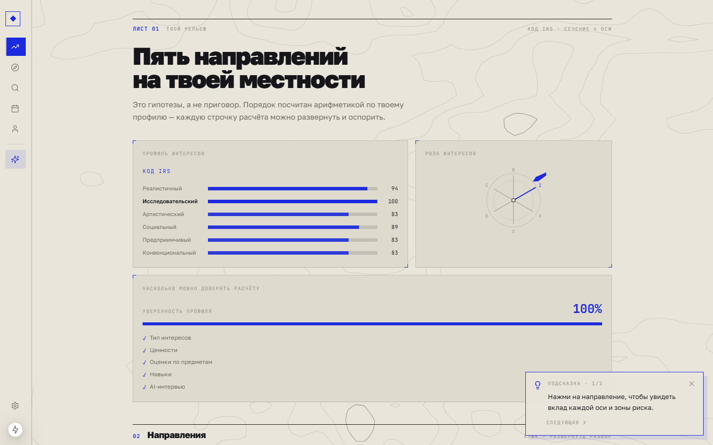
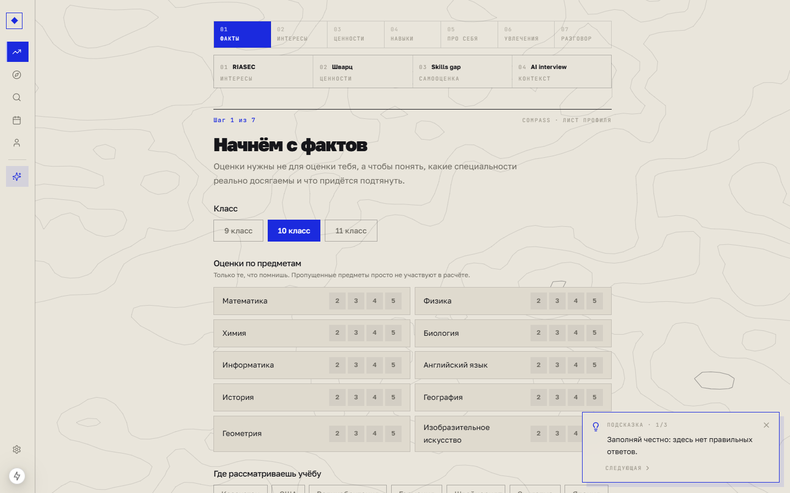
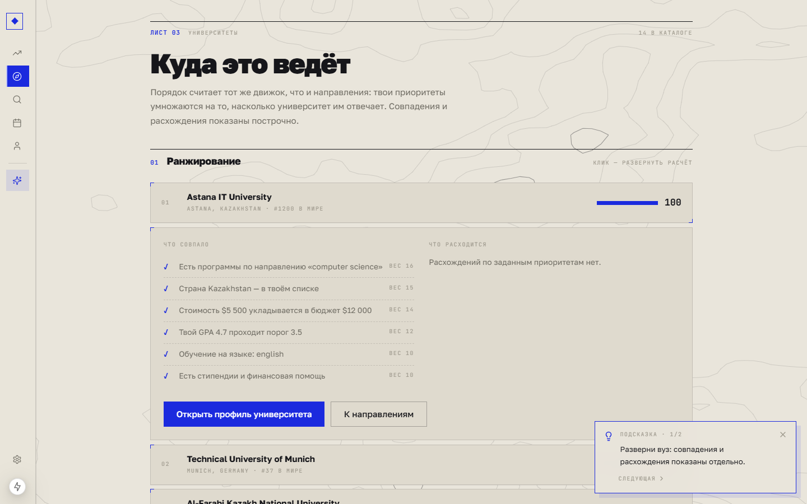
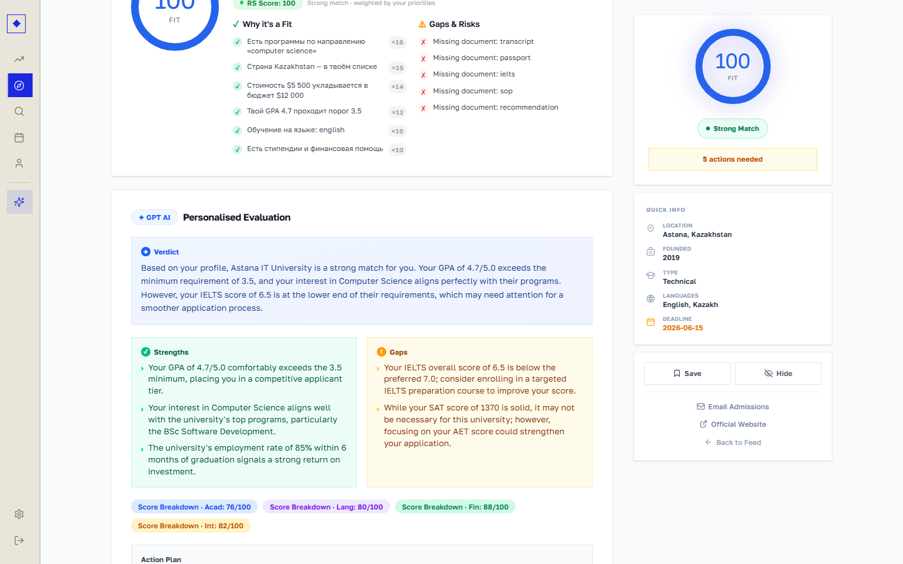
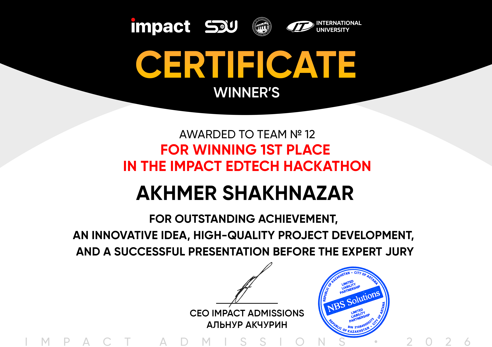

# Compass
### A career direction you can question, explain and act on.

**Impact EdTech Hackathon · 1st place · team No. 12**

A career-navigation prototype for students in grades 9–11. Compass connects interests, values, school subjects and skills to possible directions, university choices and a preparation plan.

*A demonstration interest profile shown as a landscape of possible directions. The result is a planning hypothesis, not a psychological diagnosis.*

## A profile is more than a quiz result

The entry flow moves through facts, interests, values, skills, personal context, activities and a conversation. Each source contributes a different part of the picture. Missing school marks are treated as missing information, rather than being silently converted into a poor result.

The interface uses a cartographic language: contour lines, coordinates, field-sheet typography and paths. This is tied to the product idea. The student is exploring a landscape and choosing a route, rather than being handed one supposedly inevitable profession.

*The seven-step navigator begins with school context and makes the purpose of each input visible.*

## Show the calculation, then explain it

The recommendation layer uses deterministic matching: interest-vector similarity, values, subjects and skills contribute to the comparison. The language model helps interpret conversational input and explain a result; it does not secretly invent the numeric ranking.

This separation lets a student challenge a recommendation. If a direction appears high because of certain interests and subjects, the interface can expose those reasons. A changed answer should have a traceable effect on the result instead of causing an unrelated new personality description.

### From a direction to a place to study

The university layer connects a possible path to practical constraints such as country, budget, teaching language, academic requirements and available support. Priorities are weighted, and the matching rows show what agrees with the profile and where a mismatch remains.

*The university list expands into weighted reasons. The illustrated catalogue and student profile are demo material.*

The detail view separates strengths, missing documents and preparation tasks. A high fit score is not an offer of admission: the student may still need a language result, transcript, recommendation or statement of purpose.

*A detailed demonstration evaluation turns the match into gaps and an action plan. Figures shown are prototype data, not current admissions advice.*

## The useful handoff is a next step

Compass links the chain **interest → direction → degree → skills → university → roadmap**. This is more useful than stopping at a list of job titles. The result should help the student choose an experiment: try a course, investigate a degree, improve a prerequisite or compare a different university.

~~~mermaid
flowchart LR
 A[Facts and self-report] --> B[Structured student profile]
 C[Guided conversation] --> B
 B --> D[Deterministic matching]
 D --> E[Reasons and gaps]
 E --> F[University comparison]
 F --> G[Preparation roadmap]
~~~

**Implementation:** Next.js 15, TypeScript, Prisma, SQLite, NextAuth, Tailwind and Framer Motion. The typographic and contour system is part of the product UI, while the ranking logic is kept distinct from its natural-language explanation.

## Scope and evidence

The screenshots document the hackathon prototype using demonstration profiles and catalogue records. Its “confidence” display reflects available profile information; it is not a calibrated probability of career success. The project does not establish psychometric validity or predict admission outcomes.

The engineering result is an explainable bridge between personal exploration and concrete planning. The student can see why a direction appeared, what remains unknown and which preparation actions follow from the comparison.

## Award certificate

**1st place at the Impact EdTech Hackathon**, team No. 12. The certificate names Akhmer Shakhnazar and displays Impact, SDU and partner institutions. Compass is the project associated with this event.

[Original documents and certificate gallery](docs/awards/README.md).

View the certificate

**Impact EdTech Hackathon — 1st place**

---

### Built by

[Shakhnazar Akhmer](https://github.com/Eye172) and the **Impact EdTech hackathon team (No. 12)**.

[More projects](https://github.com/Eye172) · [Contact](mailto:shakh090909@gmail.com)

This repository presents the product and its engineering. The implementation is maintained separately. Screenshots and documented experiments are identified in their captions; a live deployment is not required to explore the case study.
